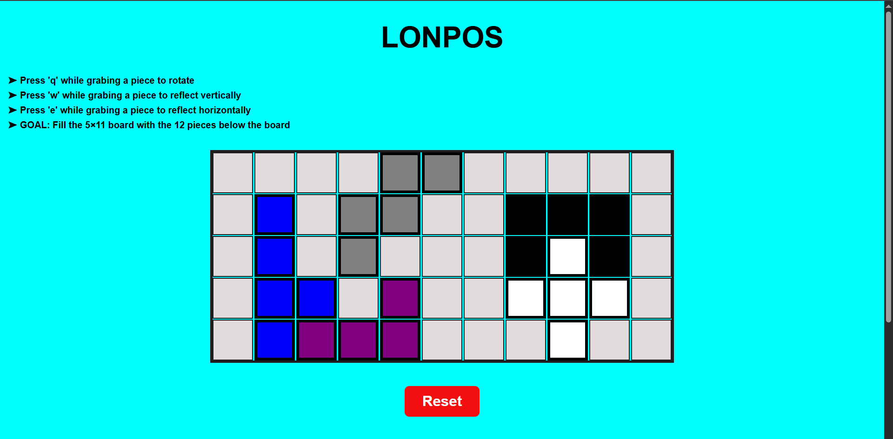
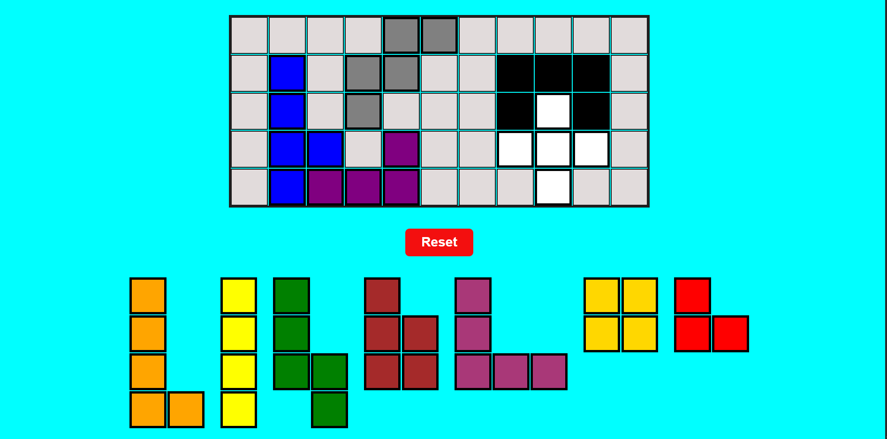

# Lonpos 2D
A browser-based 2D puzzle game inspired by Lonpos, built with HTML, CSS, and JavaScript.

## About

The goal is to fill an 11×5 board using all 12 available geometric pieces. Pieces can be dragged, rotated, and reflected to find a valid arrangement.

## Controls

| Key | Action |
|---|---|
| Q | Rotate piece 90° clockwise |
| W | Reflect vertically |
| E | Reflect horizontally |
| Mouse / Touch | Drag and place pieces |

## Project Structure

This repository contains two implementations of the same game:

### 1. ES Modules (`/es-modules`)

Uses JavaScript ES modules with `import` and `export` to separate game logic from UI functionality.

**Running:** Requires a local HTTP server. Open `index.html` through the server.

### 2. Classic Scripts (`/classic-scripts`)

Uses regular JavaScript scripts without ES modules.

**Running:** Open `index.html` directly in a browser. No local server is required.

## Technologies

- HTML5
- CSS3
- JavaScript

## Running Locally

You can run either version using a local development server, or open the classic-scripts version directly in your browser.
